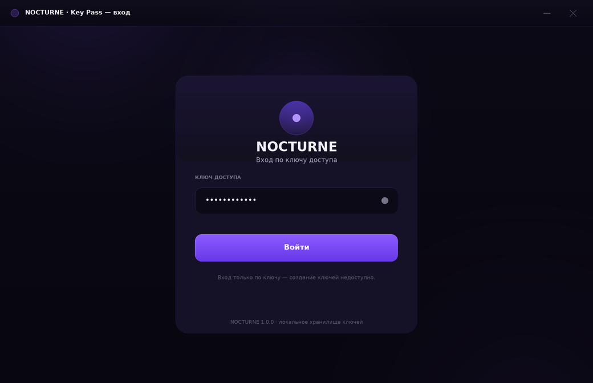
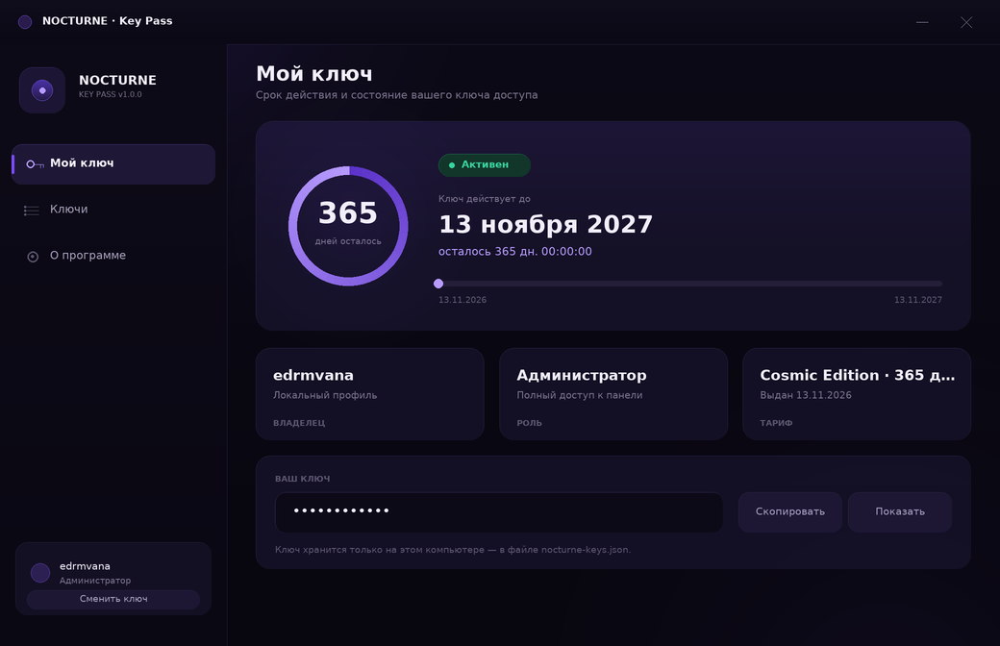
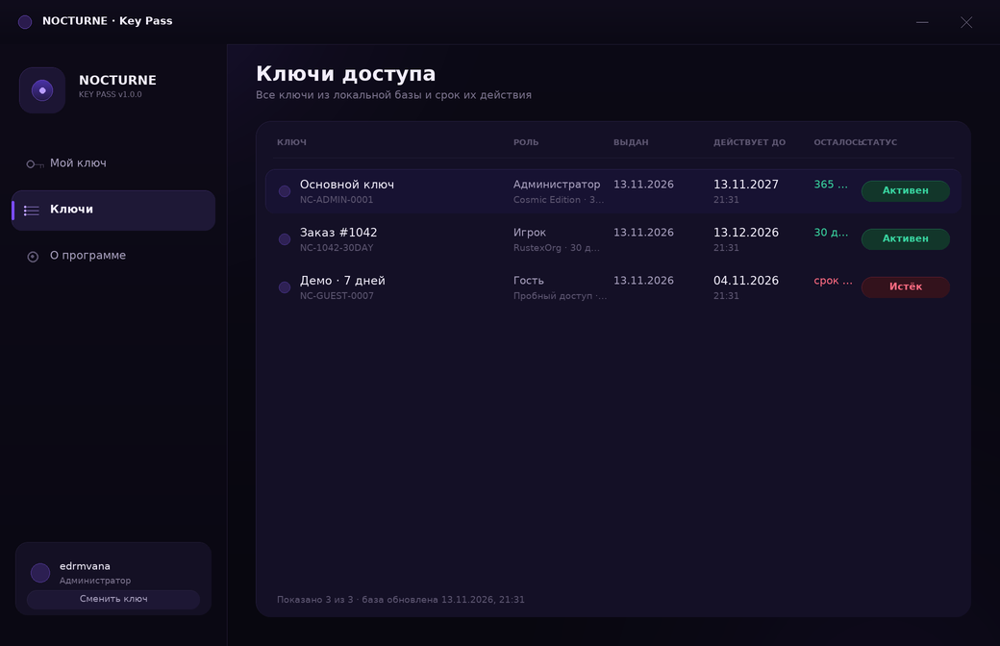

# NOCTURNE Key Pass — настольное приложение (C++, Windows)

Нативное приложение под Windows: **вход по ключу доступа**, срок действия ключа,
список всех ключей из локальной базы. Один `.exe`, без внешних библиотек и без
установки — интерфейс рисуется средствами Win32 + GDI+.







## Что изменилось по сравнению с панелью на ключах

| Было (`admin.html` / Python Admin Desk) | Стало (`NOCTURNE Key Pass`) |
| --- | --- |
| Веб-страница с генерацией одноразовых ключей | Отдельная программа `.exe` на C++ |
| Вход по паролю администратора | **Вход по ключу доступа** |
| Срок действия ключа не показывался | **Дата окончания, обратный отсчёт и шкала срока** |
| Данные только в браузере | Локальный файл `nocturne-keys.json` рядом с программой |
| Зависит от браузера | Работает автономно, без браузера |

## Возможности

* **Вход по ключу.** Никакой генерации: ввели ключ — открылся личный кабинет ключа.
  Ключ можно показать или скрыть, ввод нечувствителен к пробелам и регистру.
* **Дата окончания ключа.** Крупная дата, статус (активен / истекает / истёк /
  отозван), обратный отсчёт до секунды и шкала всего срока действия.
* **Три экрана:** «Мой ключ», «Ключи» (для администратора — все ключи базы с
  датами окончания и остатком срока), «О программе».
* **Плавный интерфейс:** кроссфейд и сдвиг при переходах, мягкие состояния
  наведения и нажатия, анимация появления кольца срока, тряска при неверном
  ключе, аккуратная работа с тёмной темой Windows, скруглённые углы окна.
  Если в системе отключены анимации — приложение их не проигрывает.
* **Масштабирование.** Высокая чёткость на экранах с любым DPI, окно можно
  тянуть за края и за верхнюю панель, есть свёртывание в панель задач.
* **Безопасность хранения.** В файле лежат только SHA-256 хеши, сами ключи
  держатся в памяти и не записываются на диск.

## Готовый файл

`dist/NOCTURNE-KeyPass.exe` уже собран (MinGW-w64, x86-64, Windows 10 и новее).
Скопируйте его в любую папку и запустите — рядом появится `nocturne-keys.json`.

Если нужен свой exe — соберите из исходников (см. ниже).

## Сборка из исходников

### Windows

```
build.bat
```

Скрипт сам выберет компилятор: сначала MSVC (`cl.exe`, запускайте из
*Developer Command Prompt for VS* или установите Build Tools), затем MinGW-w64
(`g++` должен быть в `PATH`). Результат — `dist\NOCTURNE-KeyPass.exe`.

### Linux / macOS (кросс-сборка)

```sh
./build.sh           # MinGW-w64, либо Zig, если MinGW не установлен
```

Нужен один из вариантов:

* `x86_64-w64-mingw32-g++` — `apt install mingw-w64` или `brew install mingw-w64`;
* `zig` — `zig c++` сам кросс-компилирует под Windows, ничего больше качать не надо.

### Тесты

Портируемая часть (криптография, JSON, даты, база ключей, раскладка интерфейса)
проверяется обычным `g++` без Windows:

```sh
g++ -std=c++17 -Wall -Wextra src/nc_core.cpp src/nc_paths.cpp src/nc_draw.cpp \
    src/nc_view.cpp tests/nc_tests.cpp -o nc_tests && ./nc_tests
```

Тесты считают раскладку экранов и следят, чтобы ничего не вылезало за границы
окна и не перекрывало другие элементы.

### Картинки для документации

```sh
g++ -std=c++17 -o dump_layout tools/dump_layout.cpp src/nc_core.cpp src/nc_paths.cpp \
    src/nc_draw.cpp src/nc_view.cpp
./dump_layout login 1040 672 > /tmp/login.json
python3 tools/render_preview.py /tmp/login.json docs/preview-login.png
```

`tools/render_preview.py` рисует ту же самую раскладку, что и программа
(шрифт DejaVu вместо Segoe UI), поэтому картинки совпадают с интерфейсом.

## Ключи по умолчанию

При первом запуске создаётся файл с тремя демо-ключами:

| Ключ | Роль | Срок |
| --- | --- | --- |
| `qwerty123123` | Администратор | 365 дней |
| `demo-30d-1042` | Игрок | 30 дней |
| `demo-guest-7d` | Гость | уже истёк |

Администратор видит экран «Ключи» со всеми ключами базы.

## Файл ключей `nocturne-keys.json`

Создаётся рядом с программой (если папка недоступна для записи — в
`%APPDATA%\NOCTURNE`). Формат:

```json
{
  "version": 1,
  "updatedAt": "2026-11-13T21:00:00Z",
  "keys": [
    {
      "id": "NC-ADMIN-0001",
      "label": "Основной ключ",
      "owner": "edrmvana",
      "role": "admin",
      "plan": "Cosmic Edition · 365 дней",
      "hash": "230fce14f93a97a604b0fcbb597360dc386f9bae15fe6a13f8b8696aa3e562a5",
      "issuedAt": "2026-11-13T21:00:00Z",
      "expiresAt": "2027-11-13T21:00:00Z",
      "status": "active",
      "note": "Ключ администратора."
    }
  ]
}
```

* `role`: `admin` (видит все ключи), `player`, `guest`.
* `status`: `active` или `revoked`.
* `issuedAt` / `expiresAt`: UTC в формате `YYYY-MM-DDTHH:MM:SSZ`.
* `hash`: SHA-256 от **нормализованного** ключа — все пробелы удаляются,
  буквы приводятся к нижнему регистру. Поэтому `QWERTY 123123` и
  `qwerty123123` — один и тот же ключ.

Посчитать хеш для нового ключа:

```sh
python3 -c "import hashlib,sys; print(hashlib.sha256(''.join(sys.argv[1].split()).lower().encode('utf-8')).hexdigest())" "мой новый ключ"
```

Измените файл и перезапустите программу — новые данные подхватятся сразу.
Испорченный файл не удаляется: он сохраняется как `nocturne-keys.json.bak`,
а рядом создаётся новый.

## Структура исходников

| Файл | Назначение |
| --- | --- |
| `src/nc_core.*` | SHA-256, JSON, даты, модель ключей, чтение и запись базы (без Win32) |
| `src/nc_paths.*` | Пути и преобразование UTF-8 ↔ UTF-16 |
| `src/nc_draw.*` | Палитра и список примитивов для отрисовки (без Win32) |
| `src/nc_view.*` | Состояние интерфейса, раскладка экранов, анимации (без Win32) |
| `src/nc_platform.*` | Окно Win32, GDI+, ввод, таймеры, DPI |
| `src/nc_icon.h` | Иконка приложения (PNG в base64, генерируется `tools/make_icon.py`) |
| `src/main.cpp` | Точка входа |
| `tests/nc_tests.cpp` | Модульные тесты портируемой части |
| `tools/` | Генератор иконки, выгрузка раскладки в JSON, рендер превью |

Вся логика (кроме окна) не зависит от Windows, поэтому тестируется на Linux.

## Ограничения

Это локальное демо-приложение, а не серверная система лицензирования:

* база ключей лежит на диске обычным файлом — её можно прочитать и изменить
  вручную, а хеш короткого ключа подбирается перебором;
* приложение и сайт **не синхронизируются**: для общей базы нужен backend,
  серверная проверка ключей и HTTPS;
* не используйте его для реальных платежей или персональных данных.
